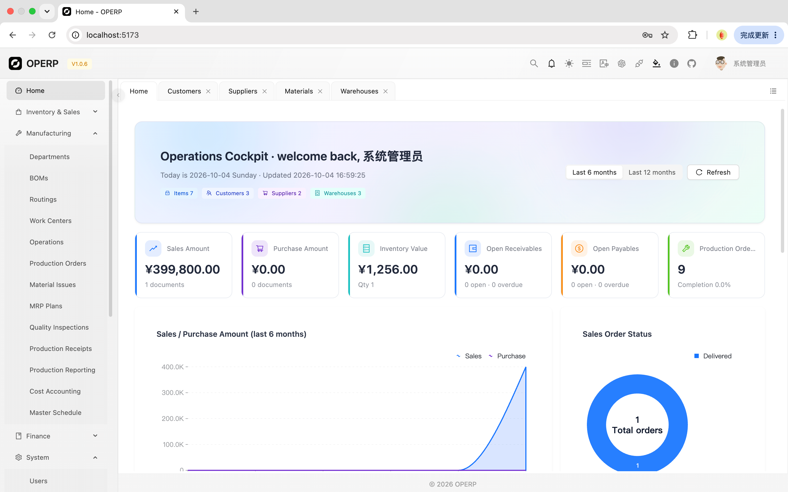

# OPERP 管理系统

一个功能完整的企业资源计划（ERP）系统，采用现代前端技术栈构建，并集成 AI 智能对话能力。

---

## 🛠️ 技术栈

### 前端框架与工具
- **React 18.2** - UI 组件库
- **TypeScript 5.9** - 类型安全的 JavaScript
- **Vite 5.4** - 构建工具（快速开发体验）
- **React Router DOM 6.26** - 路由管理

### UI 组件库
- **Ant Design 6.3** - 企业级 UI 组件库
- **Ant Design X 2.8** - AI 对话组件与智能交互能力
- **Pro Components 3.1** - 专业组件（表格、表单等）
- **Tailwind CSS 3.4** - 实用优先的 CSS 框架
- **Lucide React 0.436** - 图标库

### 数据库与后端服务
- **Supabase** - 后端即服务（BaaS）平台
  - PostgreSQL 数据库
  - 实时数据库、认证、存储等功能
  - @supabase/supabase-js 2.45

### AI 与大模型
- **@ant-design/x** - AI 对话 UI 组件
- **Ollama** - 支持本地大模型对话，例如 Qwen、Llama、DeepSeek 等
- **LocalStorage 模型配置** - 支持在浏览器中维护多个模型服务配置
- **OPERP 数据增强** - 对话前自动查询真实 ERP 数据并注入 prompt

### 工具库
- **dayjs 1.11** - 轻量级日期处理库
- **rc-field-form 2.7** - 表单管理库

---

## 🏗️ 架构设计

### 架构类型
- 前端 SPA（单页面应用）架构
- 无独立后端，使用 Supabase 作为 BaaS 服务
- 前后端通过 Supabase SDK 直接交互
- AI 能力运行在前端侧：先识别用户意图，再按需查询 Supabase 或调用大模型服务

### 目录结构
```
src/
├── components/       # 公共组件（Layout、ProLayout、AIChatDrawer）
│   ├── AIChatDrawer.tsx # AI 智能对话侧边栏
│   └── AIChatDrawer.css # AI 对话样式
├── pages/            # 页面组件（按业务模块划分）
│   ├── finance/      # 财务模块
│   ├── inventory/    # 进销存模块
│   ├── mrp/          # 生产制造模块
│   └── system/       # 系统管理模块
├── types/            # TypeScript 类型定义
├── utils/            # 工具函数（Supabase 客户端、日志、AI 工具）
│   ├── aiAnalysisTools.ts # AI 财务/库存/生产数据分析工具
│   └── aiCreateTools.ts   # AI 创建业务数据工具
├── App.tsx           # 主应用组件（路由配置）
└── main.tsx          # 应用入口
```

### 路由结构
- `/` - 首页（Dashboard）
- `/finance/*` - 财务管理模块
- `/inventory/*` - 进销存管理模块
- `/mrp/*` - 生产制造 MRP 模块
- `/system/*` - 系统管理模块

---

## 🗄️ 数据库设计

### 数据库平台
Supabase PostgreSQL

### 数据表（40+ 张表）

| 模块 | 主要表 |
|------|--------|
| **系统管理** | `sys_users`、`sys_roles`、`sys_menus`、`sys_logs` |
| **基础数据** | `erp_companies`、`erp_departments`、`erp_employees` |
| **进销存** | `erp_customers`、`erp_suppliers`、`erp_products`、`erp_warehouses`、`erp_inventory`、`erp_purchase_orders`、`erp_sales_orders`、`erp_purchase_receipts`、`erp_sales_deliveries` |
| **财务** | `erp_account_subjects`、`erp_vouchers`、`erp_receivables`、`erp_payables`、`erp_fixed_assets` |
| **生产 MRP** | `erp_boms`、`erp_routing_operations`、`erp_work_centers`、`erp_operations`、`erp_production_orders`、`erp_mrp_plans` |

### 数据库特点
- 所有表都有标准字段：`id`、`corp_id`、`emp_id`、`is_deleted`、`created_at`、`updated_at`
- 完整的外键关联设计
- 支持软删除（`is_deleted` 字段）
- TypeScript 类型自动生成（`types/database.ts`）
- AI 创建业务数据时通过 Supabase SDK 直接写入对应业务表

---

## 🤖 AI 智能对话

系统已集成基于 **Ant Design X** 的 AI 智能对话侧边栏。用户可以在任意业务页面点击右上角的 OpenAI 图标打开右侧抽屉，与本地或远程大模型进行 ERP 业务问答、数据分析和业务数据创建。

### 入口与交互
- 入口位置：顶部导航栏右上角 OpenAI 图标
- 展示方式：右侧 Drawer 侧边栏，不打断当前业务页面
- 对话组件：使用 `@ant-design/x` 的 `Bubble`、`Sender`、`Prompts`、`Welcome`、`XProvider`
- 快捷提示：内置财务分析、库存排查、生产分析、新增业务等提示词
- 多轮创建：当用户提供的信息不足时，AI 会保留当前创建上下文，继续追问缺失字段
- 清空对话：清空消息时会同步清除当前待补充的创建上下文

### 大模型配置

AI 模型配置保存在浏览器 `localStorage`，不需要写死在环境变量中。用户可以在 AI 对话窗口底部点击齿轮按钮维护多个模型配置。

支持的配置项：
- **显示名称**：例如 `Ollama 本地`、`Qwen 本地`、`OpenAI 代理`
- **接口类型**：`Ollama` 或 `Proxy`
- **接口地址**：模型服务请求地址
- **模型名称**：例如 `qwen2.5`、`llama3.1`、`deepseek-r1`
- **API Key**：可选，Ollama 本地通常不需要

Ollama 本地服务推荐配置：

```text
接口类型：Ollama
接口地址：http://localhost:11434/api/chat
模型名称：填写本机已拉取的模型，例如 qwen2.5、llama3.1
API Key：留空
```

Ollama 请求格式已做兼容，系统会向 `/api/chat` 发送如下结构：

```json
{
  "model": "qwen2.5",
  "messages": [
    { "role": "user", "content": "用户输入内容" }
  ],
  "stream": false
}
```

普通代理接口会发送 `model`、`messages`、`stream: false`，并在配置了 API Key 时自动携带 `Authorization: Bearer <API Key>` 请求头。

### ERP 数据分析能力

AI 在发送请求给大模型前，会先根据用户问题自动识别是否需要读取 ERP 真实数据。如果识别到财务、库存或生产相关意图，系统会查询 Supabase，将数据摘要注入 prompt，再交给大模型生成回答。

支持的分析域：

| 分析域 | 识别关键词示例 | 查询数据 |
|--------|----------------|----------|
| 财务分析 | 财务、应收、应付、凭证、资产、账款、成本 | 应收、应付、凭证、固定资产 |
| 库存分析 | 库存、存货、物料、仓库、低库存、积压、采购、销售出货 | 库存、物料、仓库、采购订单、销售订单 |
| 生产分析 | 生产、工单、生产订单、MRP、BOM、工序、工作中心、延期 | 生产订单、MRP 计划、MRP 需求、工作中心、物料 |

AI 分析会尽量输出：
- 关键指标：数量、金额、状态分布、完成率、报废率等
- 异常风险：逾期应收/应付、低库存、负库存、延期订单、MRP 净需求等
- 可能原因：基于摘要数据推断，不编造没有查询到的数据
- 处理建议：给出可执行的业务处理方向

示例问题：

```text
帮我分析一下财务情况，有没有逾期应收和应付风险？
查询一下库存情况，哪些物料低于安全库存？
分析当前生产订单，有没有延期和报废异常？
```

### ERP 业务数据创建能力

AI 对话支持通过自然语言创建业务数据。系统会先在前端识别创建意图并解析字段，字段完整且格式正确时直接写入 Supabase；如果字段缺失或格式不正确，会继续向用户索要更正后的详细数据。

已支持创建的业务对象：

| 模块 | 支持对象 |
|------|----------|
| 基础资料 | 客户、供应商、物料、仓库、部门 |
| 采购销售 | 采购订单、销售订单、采购入库、销售出货 |
| 生产制造 | BOM、工艺路线、工作中心、工序、生产订单 |

创建流程：
1. 用户输入新增指令，例如“帮我新增物料”
2. 系统识别业务对象和已提供字段
3. 如果缺少必填字段，AI 回复缺失字段清单和示例格式
4. 用户继续补充字段，系统合并多轮上下文
5. 字段校验通过后，系统调用 Supabase 插入数据
6. AI 返回创建成功信息、记录 ID 和创建内容摘要

示例：

```text
新增物料，物料编码 M001，物料名称 轴承A，单位 个，采购价 10，销售价 15，安全库存 100
```

```text
新增供应商，供应商编码 S001，供应商名称 华东五金，联系人 张三，电话 13800000000
```

```text
新增生产订单，产品ID 12，计划数量 100，计划开始日期 2026-07-01，计划结束日期 2026-07-05
```

字段校验能力：
- 数字字段会校验是否为数字，例如金额、价格、数量、库存、ID
- 日期字段建议使用 `YYYY-MM-DD`，也支持“今天”
- 枚举字段会校验可选值，例如状态、类型、等级
- 布尔字段支持“是/否”“启用/停用”“允许/不允许”

当前创建能力说明：
- 采购入库、销售出货、BOM、工艺路线、生产订单目前创建主表记录
- 明细行、库存数量联动、订单状态流转等复杂业务动作后续可继续扩展
- 所有写入动作都会通过 `logWithTiming` 记录操作日志，便于排查请求和性能

### AI 相关文件

| 文件 | 说明 |
|------|------|
| `src/components/AIChatDrawer.tsx` | AI 对话抽屉、模型配置、发送逻辑、创建/分析工具调度 |
| `src/components/AIChatDrawer.css` | AI 对话窗口样式 |
| `src/utils/aiAnalysisTools.ts` | 财务、库存、生产分析工具，负责查询 Supabase 并生成数据摘要 |
| `src/utils/aiCreateTools.ts` | 业务数据创建工具，负责意图识别、字段解析、校验、追问和插入 |
| `src/components/ProLayout.tsx` | 顶部 OpenAI 图标入口和 AI 抽屉挂载 |

---

## 📦 依赖分析

### 生产依赖
```json
{
  "@ant-design/icons": "^6.1.1",          // 图标
  "@ant-design/pro-components": "3.1.12-0", // Pro 组件
  "@ant-design/x": "^2.8.0",              // AI 对话组件
  "@antv/x6": "^3.1.7",                  // 图形/流程能力
  "antd": "^6.3.5",                       // Ant Design 组件库
  "bcryptjs": "^3.0.3",                   // 密码哈希
  "dayjs": "^1.11.20",                    // 日期处理
  "operp-print-designer": "^1.1.3",       // 打印设计器
  "rc-field-form": "^2.7.1",              // 表单管理
  "react": "^18.2.0",                     // React
  "react-dom": "^18.2.0"                  // React DOM
}
```

### 开发依赖
```json
{
  "@supabase/supabase-js": "^2.45.0",  // Supabase 客户端
  "@types/react": "^18.3.3",           // React 类型
  "@types/react-dom": "^18.3.0",       // React DOM 类型
  "@vitejs/plugin-react": "^4.3.1",    // Vite React 插件
  "autoprefixer": "^10.4.19",          // CSS 前缀
  "eslint": "^9.9.0",                  // 代码检查
  "postcss": "^8.4.39",                // CSS 处理
  "react-router-dom": "^6.26.0",       // 路由
  "tailwindcss": "^3.4.7",             // Tailwind CSS
  "typescript": "^5.9.3",              // TypeScript
  "vite": "^5.4.0"                     // 构建工具
}
```

---

## 🎯 业务模块

系统包含 **4 大核心模块**，共 **20+ 业务功能页面**：

### 1. 🏠 首页
- Dashboard 仪表盘

### 2. 💰 财务管理模块
- 会计科目管理
- 凭证管理
- 应收账款管理
- 应付账款管理
- 固定资产管理
- AI 财务情况分析

### 3. 📦 进销存管理模块
- 客户管理
- 供应商管理
- 物料管理
- 仓库管理
- 库存查询
- 采购订单管理
- 销售订单管理
- 采购入库管理
- 销售出货管理
- AI 库存分析与业务数据创建

### 4. 🏭 生产制造 MRP 模块
- BOM（物料清单）管理
- 工艺路线管理
- 工作中心管理
- 工序管理
- 生产订单管理
- MRP 计划管理
- AI 生产情况分析与生产基础数据创建

### 5. ⚙️ 系统管理模块
- 用户管理
- 角色管理
- 菜单管理
- 日志管理

---

## 🔑 关键特性

1. **企业级设计** - 使用 Ant Design + Pro Components
2. **类型安全** - 完整的 TypeScript 类型定义
3. **现代化工具链** - Vite 快速开发
4. **无服务器架构** - Supabase 简化后端开发
5. **完整的 ERP 业务流程** - 覆盖制造企业核心流程
6. **模块化设计** - 业务模块清晰分离
7. **响应式布局** - Tailwind CSS 实现
8. **AI 智能对话** - 支持多模型配置、Ollama 本地模型、ERP 数据分析和业务数据创建
9. **真实数据增强回答** - AI 回答财务、库存、生产问题前会读取 Supabase 数据摘要
10. **自然语言创建业务数据** - 支持客户、供应商、物料、仓库、订单、BOM、工艺路线、生产订单等创建

---

## 🚀 启动方式

```bash
# 安装依赖
npm install

# 启动开发服务器
npm run dev

# 构建生产版本
npm run build

# 代码检查
npm run lint
```

### Ollama 本地模型准备

如果使用 Ollama 本地模型，需要先启动 Ollama 服务，并拉取至少一个模型：

```bash
ollama serve
ollama pull qwen2.5
```

然后在 AI 对话窗口模型配置中填写：

```text
接口地址：http://localhost:11434/api/chat
模型名称：qwen2.5
```

---

## 📝 项目概述

这是一个功能完整、架构清晰的 **现代化 ERP 前端系统**，适合作为制造企业的信息化管理平台。系统不仅提供传统 ERP 的财务、库存、采购、销售和生产制造功能，还集成了 AI 智能对话能力，可基于真实 opelix 数据进行分析，并通过自然语言创建常用业务数据。

---

© 2026 OPERP System
